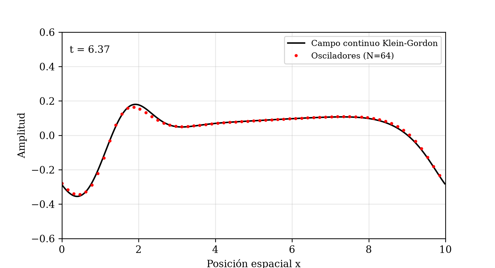

<div align="center">

# Classical Field Theory from Coupled Anharmonic Oscillators

**From Discrete Lattice Mechanics to Continuum Scalar Fields**

[](https://www.python.org/)
[](https://numpy.org/)
[](https://matplotlib.org/)
[](https://www.latex-project.org/)

</div>

---

## Live Dynamics

<div align="center">
  
  <p><em>Real-time symplectic evolution: <b>N = 64</b> discrete oscillators (red markers) tracking the continuous self-interacting Klein–Gordon wave packet (black curve) across periodic boundaries.</em></p>
</div>

---

## Core Physics

This project demonstrates how a 1D periodic chain of $N$ **nonlinear coupled oscillators** converges into a **self-interacting Klein–Gordon scalar field** upon shrinking the lattice spacing ($a = \ell/N \to 0$):

* **Discrete Lattice:** Masses $m$ coupled via harmonic ($\kappa$) and anharmonic ($\alpha, \beta$) springs plus local nonlinearities ($g_3, g_4$).
* **Symplectic Integration:** Time-stepped via **Velocity Verlet** ($\Delta t = \nu_{\text{CFL}}\,a/c$), preserving phase-space structure and total energy $H(t)$.
* **Continuum Emergence:** Rescaling $\phi(x_n, t) = \sqrt{\rho}\,q_n(t)$ recovers the Klein–Gordon PDE with second-order global convergence ($\epsilon_{L^2} \propto a^2$).

<details>
<summary><b>Click to expand Governing Equations & Continuum Scaling Rules</b></summary>
<br>

**Continuum Field Equation (Klein–Gordon):**
$$\partial_t^2\phi - c^2\partial_x^2\phi + \mu^2 c^2\phi + \lambda_3\phi^2 + \lambda_4\phi^3 = 0$$

**Invariant Parametric Rescaling ($a = \ell/N \to 0$):**

| Parameter | Discrete | Continuum | Scaling Rule |
| :--- | :---: | :---: | :--- |
| **Field Amplitude** | $q_n(t)$ | $\phi(x,t)$ | $\phi(x_n,t) = \sqrt{\rho}\,q_n(t)$ |
| **Inertia & Tension** | $m, \; \kappa$ | $\rho, \; \tau$ | $m = \rho a, \quad \kappa = \tau / a$ |
| **Wave Speed & Mass** | $a\sqrt{\kappa/m}, \; \omega_0$ | $c, \; \mu$ | $c = \sqrt{\tau/\rho}, \quad \omega_0 = \mu c$ |
| **On-Site Couplings** | $g_3, \; g_4$ | $\lambda_3, \; \lambda_4$ | $g_3 = a\rho^{3/2}\lambda_3, \quad g_4 = a\rho^2\lambda_4$ |

</details>

---

## Results Gallery

<table>
  <tr>
    <td width="50%" align="center">
      <b>1. Spatiotemporal Energy Map</b><br><br>
      <a href="fig1_mapa_energia.pdf"></a>
      <details>
        <summary>Physical Takeaway</summary>
        <p align="left">Local energy density $h_n(t)$ travels at group velocity $v_g \approx c$, wrapping across periodic boundaries at $t \approx 5.0$ with a dispersive wake induced by $\mu > 0$.</p>
      </details>
    </td>
    <td width="50%" align="center">
      <b>2. Multimodal Energy Transfer</b><br><br>
      <a href="fig2_transferencia_modal.pdf"></a>
      <details>
        <summary>Physical Takeaway</summary>
        <p align="left">Anharmonic couplings redistribute energy from the fundamental mode $k=1$ into higher harmonics ($k=2,3,4$) while total energy $H(t)$ remains conserved.</p>
      </details>
    </td>
  </tr>
  <tr>
    <td width="50%" align="center">
      <b>3. Wave Propagation Snapshots</b><br><br>
      <a href="fig3_propagacion_snapshots.pdf"></a>
      <details>
        <summary>Physical Takeaway</summary>
        <p align="left">Coarse lattices ($N=32$) accumulate discrete phase lag over time ($t \in [0, 12.5]$), whereas fine lattices ($N=128$) match the continuum Klein–Gordon profile point by point.</p>
      </details>
    </td>
    <td width="50%" align="center">
      <b>4. Continuum Convergence Error</b><br><br>
      <a href="fig4_error_epsilon.pdf"></a>
      <details>
        <summary>Physical Takeaway</summary>
        <p align="left">Global error $\epsilon_{L^2}(a, T)$ scales with an exact slope of <b>2.00</b> ($\mathcal{O}(a^2)$) in both free and interacting regimes for $N \in \{32, \dots, 512\}$.</p>
      </details>
    </td>
  </tr>
</table>

> *Click any figure above to open its high-resolution vector `.pdf` version.*

---

## Quick Start

```bash
# 1. Clone the repository
git clone https://github.com/KayroRR/Classical-field-theory-from-anharmonic-oscillators.git
cd Classical-field-theory-from-anharmonic-oscillators

# 2. Install dependencies & run simulation
pip install numpy matplotlib pillow
python Oscilators_KelinGordon.py
```

<details>
<summary><b>Repository Structure</b></summary>

```text
├── Oscilators_KelinGordon.py      # Solver, spectral diagnostics & animation generator
├── main.tex                       # REVTeX4 two-column manuscript
├── Meca.bib                       # BibTeX references
├── animacion_propagacion.gif      # Real-time wave propagation animation
├── fig1_mapa_energia.pdf          # Figure 1: Local energy heatmap
├── fig2_transferencia_modal.pdf   # Figure 2: Fourier modal energy exchange
├── fig3_propagacion_snapshots.pdf # Figure 3: 6-snapshot wave comparison
└── fig4_error_epsilon.pdf         # Figure 4: Log-log L2 error scaling
```

</details>
